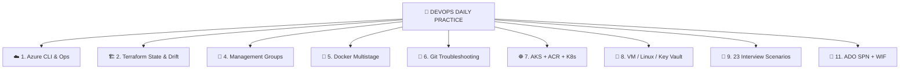
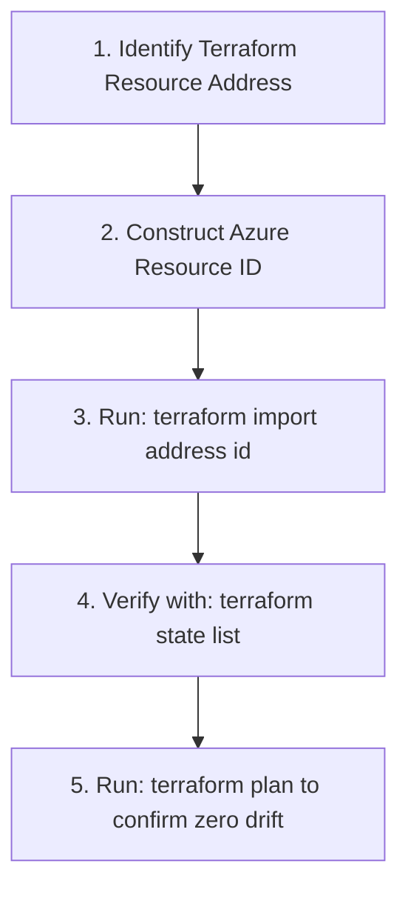
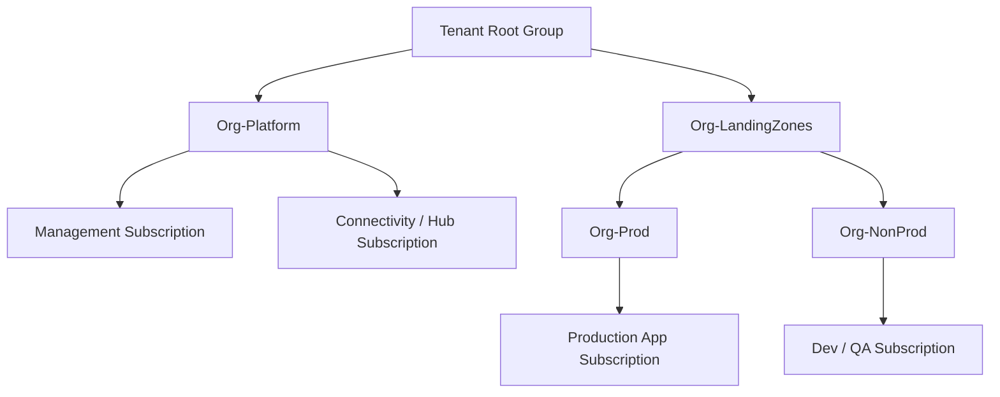
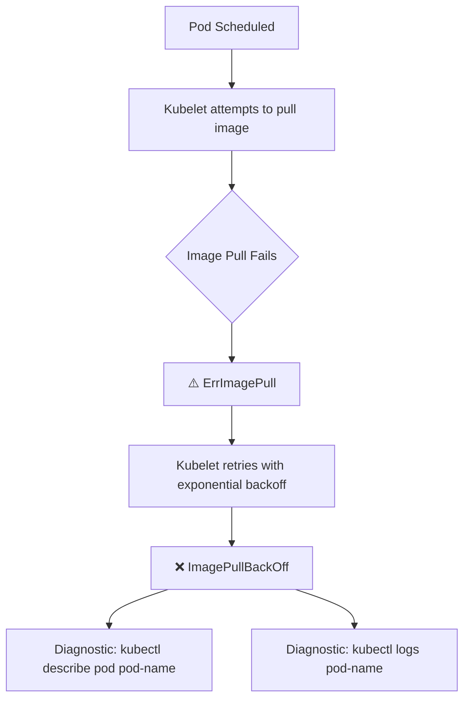
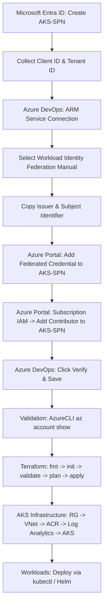

# 🚀 DevOps Daily Practice — Single Consolidated Study Book

[](https://azure.microsoft.com/)
[](https://www.terraform.io/)
[](https://www.docker.com/)
[](https://kubernetes.io/)
[](https://git-scm.com/)
[](#-security-notes--credential-hygiene)

> **Azure CLI + Terraform + Git + Docker + AKS/Kubernetes + VM + Management Groups + 23 Interview Scenarios + SPN / Workload Identity Federation (WIF)**  
> *All real-world daily practice notes consolidated into one reading flow with production troubleshooting patterns, commands, and interview scenarios.*

---

## 📑 Table of Contents

1. [🎯 Master DevOps Mental Map & Troubleshooting Sequence](#-master-devops-mental-map--troubleshooting-sequence)
2. [☁️ 1. Azure CLI + Daily Azure Operations](#-1-azure-cli--daily-azure-operations)
3. [🏗️ 2. Terraform State, Import, Drift & Resource Lifecycle](#-2-terraform-state-import-drift--resource-lifecycle)
4. [🔐 3. Terraform Authentication, SPN & Secrets](#-3-terraform-authentication-spn--secrets)
5. [🏢 4. Azure Management Groups — Interview + Design Notes](#-4-azure-management-groups--interview--design-notes)
6. [🐳 5. Docker — Multistage Build + Daily Commands](#-5-docker--multistage-build--daily-commands)
7. [🔀 6. Git — Remote, Push, Large Files, Secrets & Nested Repositories](#-6-git--remote-push-large-files-secrets--nested-repositories)
8. [☸️ 7. AKS + ACR + Kubernetes Practice](#-7-aks--acr--kubernetes-practice)
9. [🔑 8. Key Vault + VM / Linux Troubleshooting](#-8-key-vault--vm--linux-troubleshooting)
10. [🧠 9. Terraform Interview Scenario Bank (23 Scenarios)](#-9-terraform-interview-scenario-bank-23-scenarios)
11. [📋 10. Daily One-Page Revision & Troubleshooting Order](#-10-daily-one-page-revision--troubleshooting-order)
12. [🚀 11. Azure DevOps SPN + WIF — Existing Portal Practice](#-11-azure-devops-spn--wif--existing-portal-practice)

---

## 🎯 Master DevOps Mental Map & Troubleshooting Sequence



### 🎯 Systematic Troubleshooting Order

```text
Azure:
CLI → resource exists? → permissions → network → Terraform state → plan

Terraform:
error → resource address → Azure actual state → state → config → plan

Git:
status → remote → branch → .gitignore → secrets/large files → commit → push

Docker:
Dockerfile → build → image → container → port → logs

AKS:
kubectl get → describe → logs → image/tag → ACR access → network
```

---

## ☁️ 1. Azure CLI + Daily Azure Operations

### Core Commands
```bash
# 1. Login to Azure
az login

# 2. List all accessible subscriptions
az account list --output table

# 3. Retrieve active subscription ID in TSV format
az account show --query id --output tsv

# 4. Set/switch active subscription
az account set --subscription <subscription-id>

# 5. Inspect resource group
az group show --name <RG-NAME>

# 6. Query resource group location only
az group show --name <RG-NAME> --query location -o table

# 7. List resources in table format
az resource list -o table

# 8. List virtual machines
az vm list -o table
```

### Storage / Terraform Backend Practice
```bash
# Create Resource Group for Terraform State
az group create --name aksrg --location "East US"

# Create Azure Storage Account with LRS redundancy
az storage account create \
  --name askustg \
  --resource-group aksrg \
  --location eastus \
  --sku Standard_LRS \
  --kind StorageV2

# Create Blob Container for tfstate using Azure AD login credentials
az storage container create \
  --name tfstate \
  --account-name askustg \
  --auth-mode login
```

### Resource Discovery & Diagnostics
```bash
# Discover existing subnets in a virtual network
az network vnet subnet list \
  --resource-group <RG> \
  --vnet-name <VNET> \
  -o table

# Discover network interfaces (NICs) in a resource group
az network nic list \
  --resource-group <RG> \
  -o table
```

### Virtual Machine Operations
```bash
# Start a stopped VM
az vm start --name <VMName> --resource-group <RGName>
```

> [!NOTE]
> If a portal operation fails due to subscription context, use `az account set --subscription <subscription-id>` to ensure CLI and Portal contexts align.

---

## 🏗️ 2. Terraform State, Import, Drift & Resource Lifecycle

### Key Idea
Terraform state tells Terraform which real Azure resources it is tracking. The primary commands:
```bash
terraform state list
terraform state rm <resource-address>
terraform import <resource-address> <resource-id>
terraform plan
terraform apply
terraform destroy
```

---

### Import Existing Resource Workflow
When Azure already contains a resource and Terraform fails with `resource already exists`:



#### Generic Import Syntax
```bash
terraform import <resource_address> <resource_id>
```

#### Real Examples from Notes
- **Storage Account:**
  ```bash
  terraform import azurerm_storage_account.askustg \
    "/subscriptions/<sub-id>/resourceGroups/aksrg/providers/Microsoft.Storage/storageAccounts/askustg"
  ```
- **Resource Group:**
  ```bash
  terraform import azurerm_resource_group.rg \
    "/subscriptions/<sub-id>/resourceGroups/aksrg"
  ```
- **Subnets (Root or Module):**
  ```bash
  terraform import module.frontend_subnet.azurerm_subnet.subnet \
    "/subscriptions/<sub-id>/resourceGroups/lb_rg/providers/Microsoft.Network/virtualNetworks/lb_vnet/subnets/frontend_subnet"

  terraform import module.Backend_subnet.azurerm_subnet.subnet \
    "/subscriptions/<sub-id>/resourceGroups/lb_rg/providers/Microsoft.Network/virtualNetworks/lb_vnet/subnets/backend_subnet"
  ```
- **Public IP:**
  ```bash
  terraform import module.public_ip_name.azurerm_public_ip.example \
    "/subscriptions/<sub-id>/resourceGroups/lb_rg/providers/Microsoft.Network/publicIPAddresses/lb_pip"
  ```

---

### Subnet Already Exists
When using a module calling `module "subnetcalling" { ... }` and `frontend_subnet` already exists in Azure:
```bash
terraform import module.subnetcalling.azurerm_subnet.Frontend_subnet \
  "/subscriptions/<subscription-id>/resourceGroups/lb_rg/providers/Microsoft.Network/virtualNetworks/lb_vnet/subnets/frontend_subnet"
```

---

### Subnet CIDR Overlap (`NetcfgSubnetRangesOverlap`)

#### The Error
```text
Error: NetcfgSubnetRangesOverlap
Subnet 'frontend_subnet' is not valid because its IP address range overlaps with that of an existing subnet.
```

#### Troubleshooting
```bash
az network vnet subnet list \
  --resource-group lb_rg \
  --vnet-name lb_vnet \
  -o table
```
*Inspect `AddressPrefix` across all subnets and choose a non-overlapping range in your `.tf` configuration.*

---

### Subnet Delete Procedure
```bash
az network vnet subnet delete \
  --name frontend_subnet \
  --resource-group lb_rg \
  --vnet-name lb_vnet
```

> [!WARNING]
> If the subnet is currently in use, check attached NICs first:
> ```bash
> az network nic list --resource-group lb_rg -o table
> ```
> Never delete dependencies blindly in production.

---

### State Remove (`terraform state rm`)
If a resource was manually deleted or should no longer be tracked:
```bash
terraform state rm <resource-address>

# Verify:
terraform plan
```
*(Also note: `terraform refresh` synchronizes state with real cloud state, but modern practice prefers `terraform plan` to reconcile differences).*

---

### Destructive Operations
```bash
# Destroy all managed infrastructure
terraform destroy

# Target a specific resource for destruction
terraform destroy -target <resource-address>
```

> [!CAUTION]
> Avoid direct Portal deletion for Terraform-managed resources to prevent state drift and lock corruption.

---

## 🔐 3. Terraform Authentication, SPN & Secrets

### Local CLI Flow
```bash
az logout
az login --scope https://management.azure.com/.default
```

### Automation Service Principal Creation
```bash
az ad sp create-for-rbac \
  --name terraform-sp \
  --role Contributor \
  --scopes /subscriptions/<subscription-id>
```

### AzureRM Provider Configuration
```hcl
provider "azurerm" {
  features {}

  subscription_id = var.subscription_id
  client_id       = var.client_id
  client_secret   = var.client_secret
  tenant_id       = var.tenant_id
}
```

### 🔒 Security Rules & Credential Hygiene
- **Never hardcode secrets** in `provider.tf` or code files.
- Use variables and keep sensitive `terraform.tfvars` out of Git.
- Use environment variables (`ARM_CLIENT_ID`, `ARM_CLIENT_SECRET`, `ARM_TENANT_ID`, `ARM_SUBSCRIPTION_ID`) or CI/CD secret stores.
- If a secret is committed, deleting the line is **not enough**—Git history still contains it. Clean history using `git-filter-repo`.
- Temporary GitHub secret-unblocking is **strongly discouraged** for real production secrets.
- For Azure DevOps, prefer **Workload Identity Federation (WIF)** over long-lived client secrets.

---

## 🏢 4. Azure Management Groups — Interview + Design Notes

Management Groups provide organizational hierarchy, governance, access control, and policy inheritance across multiple subscriptions.



### Key Terraform Resources
- `azurerm_management_group`
- `azurerm_management_group_subscription_association`
- `azurerm_role_assignment`
- `azurerm_policy_assignment`

### Essential Interview Points
- **Tenant Root Group** exists by default.
- A custom logical hierarchy can be built cleanly with Terraform.
- **Management Group Contributor** and **Directory Reader** roles are required for MG operations.
- Subscription association is handled with `azurerm_management_group_subscription_association`.
- Policies applied at higher MG levels have wider impact through **inheritance**.
- Child MGs can be created dynamically with `for_each`.
- Conditional creation pattern: `count = var.enable_mg ? 1 : 0`.
- Reference an MG ID: `azurerm_management_group.<name>.id`.
- Foundation for **Azure Landing Zones (ALZ)** (Identity, Management, Connectivity, Security).

### Dynamic Hierarchy Pattern
```hcl
resource "azurerm_management_group" "mg" {
  for_each                   = var.management_groups
  name                       = each.key
  display_name               = each.value.display_name
  parent_management_group_id = each.value.parent
}
```

### Dynamic Subscription Mapping
```hcl
resource "azurerm_management_group_subscription_association" "sub" {
  for_each            = var.subscription_map
  management_group_id = azurerm_management_group.mg[each.value.mg_key].id
  subscription_id     = "/subscriptions/${each.value.subscription_id}"
}
```

### Import Existing Management Group
```bash
terraform import azurerm_management_group.m1 \
  /providers/Microsoft.Management/managementGroups/<mg_id>
```

---

## 🐳 5. Docker — Multistage Build + Daily Commands

### Multistage Dockerfile (React + Nginx)
```dockerfile
# Stage 1: Build Application
FROM node:18 AS builder
WORKDIR /app
COPY package*.json ./
RUN npm install
COPY . .
RUN npm run build

# Stage 2: Production Nginx Runtime
FROM nginx:latest
COPY --from=builder /app/build /usr/share/nginx/html
EXPOSE 80
CMD ["nginx", "-g", "daemon off;"]
```

#### Why Multistage?
- **Builder Stage:** Uses heavy Node image, downloads dependencies, and builds static bundle.
- **Runtime Stage:** Copies only the final `/app/build` into a lightweight Nginx container. Eliminates source code and build tools from the production image.

---

### Daily Docker Commands
```bash
# Build Image
docker build -t react-app:v1 .

# Build Image without using Cache
docker build --no-cache -t addtask-app .

# List Images
docker images

# Run Container with Port Forwarding
docker run -d -p 8000:80 --name Asku node:v1

# Stop Container
docker stop <container-id>

# Remove Stopped Containers
docker container prune -f

# Remove All Containers (Dangerous)
docker container rm $(docker ps -aq)

# Remove Unused Images
docker image prune
docker image prune -a

# Remove All Images by ID
docker rmi $(docker images -q)

# Broad System Cleanup
docker system prune -a
```

---

## 🔀 6. Git — Remote, Push, Large Files, Secrets & Nested Repositories

### Remote & Branch Commands
```bash
# Check remote URLs
git remote -v

# Change existing origin (Do NOT use 'git remote add' if origin exists!)
git remote set-url origin https://github.com/<user>/<repo>.git

# Add new origin (when none exists)
git remote add origin https://github.com/<user>/<repo>.git

# Rename branch to main
git branch -M main

# Push with upstream tracking
git push -u origin main
```

---

### Windows Line Endings (LF / CRLF)
* **Message:** `warning: LF will be replaced by CRLF`
* **Meaning:** Normal Windows line ending conversion; not an error.
* **Global Configuration:**
  ```bash
  git config --global core.autocrlf true
  ```

---

### Large File Issue (> 100 MB Provider Executables)
* **Error:** GitHub rejects push because `terraform-provider-azurerm_....exe` is > 100 MB.
* **Root Cause:** `.terraform/` directory containing provider binaries was accidentally committed.
* **Resolution using `git-filter-repo`:**
  ```bash
  # 1. Install git-filter-repo
  pip install git-filter-repo

  # 2. Strip the directory from all commits
  git filter-repo --path .terraform/ --invert-paths --force

  # 3. Add to .gitignore
  echo ".terraform/" >> .gitignore
  ```

---

### Nested Repository Checkouts
* **Error:** `error: 'Enviroment/dev/' does not have a commit checked out. fatal: adding files failed.`
* **Diagnosis:** `Enviroment/dev/` has its own `.git` directory.
* **Fix (PowerShell):**
  ```powershell
  cd Enviroment/dev
  ls -Force

  # If not intended to be a separate submodule, remove nested .git:
  Remove-Item -Recurse -Force .git

  # Return to parent repo and stage:
  cd ../..
  git add .
  git status
  ```

---

### Secret Scanning Rejections
When GitHub rejects a push due to credential detection:
1. Remove the secret from source code.
2. Rotate/revoke the exposed credential in Azure immediately.
3. Remove the secret from Git history (`git-filter-repo`).
4. Add sensitive files (`*.tfvars`, `.env`) to `.gitignore`.
5. Use environment variables, CI secrets, or Azure Key Vault.

---

## ☸️ 7. AKS + ACR + Kubernetes Practice

### AKS / ACR Integration Sequence
```bash
# 1. Login to Azure CLI
az login

# 2. Login to Azure Container Registry
az acr login --name <ACR-NAME>

# 3. Attach ACR to AKS Cluster (Grants AcrPull role automatically)
az aks update \
  --name <AKS-NAME> \
  --resource-group <RG-NAME> \
  --attach-acr <ACR-NAME>

# 4. Get AKS Credentials (kubeconfig)
az aks get-credentials \
  --name <AKS-NAME> \
  --resource-group <RG-NAME> \
  --overwrite-existing

# 5. Install kubectl on Linux VM (if needed)
sudo az aks install-cli

# 6. Verify kubectl client version
kubectl version --client
```

---

### ACR Image Build & Push
```bash
# Tag local image for ACR
docker tag stream2:latest <ACR-NAME>.azurecr.io/stream2:latest

# Push to ACR
docker push <ACR-NAME>.azurecr.io/stream2:latest

# List repositories in ACR
az acr repository list --name <ACR-NAME> --output table
```

---

### Kubectl Recursive Documentation
```bash
kubectl explain pod --recursive > pod.txt
kubectl explain deployment --recursive > deployment.txt
```

---

### `kubectl create` vs `kubectl apply`
- **`kubectl create -f deployment.yaml`**: Imperative. Fails if the resource already exists. Best for initial testing.
- **`kubectl apply -f deployment.yaml`**: Declarative. Creates if absent, updates if exists. **Standard for CI/CD pipelines.**

---

### Zero-Downtime Rollout Restart
```bash
kubectl rollout restart deployment <deployment-name>
kubectl rollout status deployment <deployment-name>
```

---

### Pod Troubleshooting: `ErrImagePull` vs `ImagePullBackOff`



#### Primary Causes & Checks:
- **Wrong image name or tag** in deployment YAML.
- **Private ACR authentication failure** (Verify `az aks update --attach-acr`).
- **Network connectivity / Private DNS** blocking AKS nodes from ACR endpoint.

---

## 🔑 8. Key Vault + VM / Linux Troubleshooting

### Terraform Key Vault Data Source Pattern
```hcl
data "azurerm_key_vault" "kv" {
  name                = "<key-vault-name>"
  resource_group_name = "<resource-group-name>"
}

data "azurerm_key_vault_secret" "example" {
  name         = "<secret-name>"
  key_vault_id = data.azurerm_key_vault.kv.id
}
```

> [!CAUTION]
> Never commit real database passwords, connection strings, or API keys to Git. Retrieve them at runtime via Key Vault data sources.

---

### VM / Linux Diagnostics — APT Not Working

#### Step 1: Check IP and Default Route
```bash
ip a
ip route
```

#### Step 2: Test Internet Connectivity (Bypass DNS)
```bash
ping -c 4 8.8.8.8
```

#### Step 3: Inspect DNS Configuration
```bash
cat /etc/resolv.conf
```
*Expected Azure default DNS: `nameserver 168.63.129.16` or public fallback `nameserver 8.8.8.8`.*

#### Step 4: Check systemd-resolved
```bash
systemctl status systemd-resolved
```

#### Step 5: Verify Hostname Resolution
```bash
hostname
cat /etc/hosts
```
*Expected pattern:*
```text
127.0.0.1 localhost
127.0.1.1 <hostname>
```

#### Step 6: Update Packages
```bash
sudo apt update
sudo apt upgrade -y
```

---

### Nginx / Website Cannot Be Reached
```bash
# 1. Check Nginx service status
sudo systemctl status nginx

# 2. Check listening ports
sudo ss -tuln | grep 80

# 3. Test web server locally on VM
curl http://<VM-private-IP>
```
*If local curl works, the issue is an Azure Network Security Group (NSG) inbound rule or Azure Firewall blocking port 80/443.*

---

## 🧠 9. Terraform Interview Scenario Bank (23 Scenarios)

### 🎯 Universal Interview Answer Pattern
$$\text{Scenario} \longrightarrow \text{Identify Root Cause} \longrightarrow \text{Verify Cloud/Git State} \longrightarrow \text{Smallest Safe Change} \longrightarrow \text{Verify with Plan/Status} \longrightarrow \text{Document Prevention}$$

---

### 🟢 Foundation Scenarios (1–4)
1. **Remote Backend / State Locking:** Multi-user conflicts are resolved by migrating to Azure Blob Storage backend with Blob Lease state locking.
2. **Environment Separation:** Separate Dev, QA, and Prod using directory-based layouts with distinct `.tfvars` and isolated state files.
3. **Drift Detection:** `terraform plan` compares the declarative `.tf` files with real Azure infrastructure. Apply reconciles differences.
4. **Hardcoded Credentials:** Commit of plain-text passwords resolved by rotating keys immediately and reading secrets via `azurerm_key_vault` data blocks.

---

### 🟡 Networking & Security (5–7)
5. **NSG Misconfiguration:** Port exposed to `0.0.0.0/0`. Fix by enforcing least-privilege CIDR rules in Terraform and assigning Azure Policy (`Deny-Public-Inbound`).
6. **Private Database:** Prevent public exposure using `azurerm_private_endpoint`, Private DNS zones, and disabling public network access.
7. **CIDR Overlap:** VNet peering fails due to overlapping subnets. Fix by recalculating prefixes with `cidrsubnet()` and maintaining an IPAM register.

---

### 🔵 Scaling & High Availability (8–10)
8. **Single VM to HA:** Transition standalone VM to an Azure Virtual Machine Scale Set (VMSS) across Availability Zones with a Standard Load Balancer health probe.
9. **Zero-Downtime Update:** Implement rolling upgrades in VMSS or Kubernetes blue/green backend pool swaps.
10. **Auto-Scaling:** Configure `azurerm_monitor_autoscale_setting` or K8s HPA to scale out on >70% CPU usage for 5 minutes.

---

### 🟣 Production Safety (11–13)
11. **Accidental Destroy:** Apply `lifecycle { prevent_destroy = true }` and Azure Resource Management locks (`CanNotDelete`).
12. **Resource Deletion Protection:** Lock storage accounts and database instances so Terraform cannot delete them even during bad runs.
13. **Plan Approval Workflow:** CI/CD pipeline stage separation: Stage 1 creates `tfplan` artifact; Stage 2 requires manual security sign-off before running `apply`.

---

### 🔴 State & Recovery (14–15)
14. **State Corruption:** Restore the previous healthy snapshot from Azure Storage **Blob Versioning**, then run `terraform state list` and `terraform plan`.
15. **State Lock Stuck:** Ensure no active pipeline is executing, note the Lock ID, and execute `terraform force-unlock <LOCK_ID>`.

---

### 🟤 Cost Optimization (16–17)
16. **High Azure Bill:** Enforce auto-shutdown on non-production VMs, clean orphaned unattached disks and public IPs, and purchase Reserved Instances.
17. **Mandatory Tagging:** Enforce `Environment`, `Owner`, and `CostCenter` tags through provider-level `default_tags` and Azure Policy enforcement.

---

### ⚫ Enterprise Architecture (18–20)
18. **Multi-Region Disaster Recovery (DR):** Deploy active-passive infrastructure in paired regions with separate state files and Azure Front Door failover routing.
19. **Import Existing Infrastructure:** Create matching `.tf` resource definition, run `terraform import`, and reconcile with `terraform plan` until zero changes are reported.
20. **Modular Design:** Reusable enterprise modules with standardized `main.tf`, `variables.tf`, `outputs.tf`, strict variable validation, and semver tagging.

---

### 🌟 Senior Bonus Scenarios (21–23)
21. **Breaking Changes in Modules:** Follow Semantic Versioning (`v1.0.0` -> `v2.0.0`). Deprecate inputs gradually and pin root module versions (`?ref=v1.2.0`).
22. **Dependency Failure (`depends_on`):** Use explicit `depends_on` when Terraform graph cannot automatically resolve resource relationships (e.g., VM extension depending on Azure Active Directory registration).
23. **Parallel Apply Issue:** Subnet creation collisions in the same VNet. Resolve using `-parallelism=1` or chaining dependencies cleanly.

---

## 📋 10. Daily One-Page Revision & Troubleshooting Order

```text
================================================================================
                    DAILY COMMAND CHEAT SHEET
================================================================================

AZURE:
  az login
  az account list -o table
  az account show --query id -o tsv
  az account set --subscription <id>
  az group show --name <rg>
  az vm list -o table

TERRAFORM:
  terraform init
  terraform validate
  terraform plan
  terraform apply
  terraform state list
  terraform import <address> <id>
  terraform state rm <address>
  terraform destroy

GIT:
  git status
  git remote -v
  git branch
  git add .
  git commit -m "<message>"
  git push -u origin main
  git remote set-url origin <url>

DOCKER:
  docker build -t app:v1 .
  docker images
  docker run -d -p 8000:80 --name app app:v1
  docker stop <id>
  docker container prune
  docker image prune -a
  docker system prune -a
  docker build --no-cache -t app .

AKS:
  az acr login --name <acr>
  az aks update --name <aks> --resource-group <rg> --attach-acr <acr>
  az aks get-credentials --name <aks> --resource-group <rg>
  kubectl get pods
  kubectl describe pod <pod>
  kubectl logs <pod>
  kubectl apply -f deployment.yaml
  kubectl rollout restart deployment <deployment>
================================================================================
```

---

## 🚀 11. Azure DevOps SPN + WIF — Existing Portal Practice



### Complete Sequence
1. **AKS-SPN App Registration:** Created in Microsoft Entra ID. Note down Application (Client) ID and Directory (Tenant) ID.
2. **Azure DevOps ARM Service Connection:** Navigate to `Project Settings → Service connections → New service connection → Azure Resource Manager → Workload Identity Federation (manual)`.
3. **WIF Trust Values:** Copy the ADO-generated **Issuer** and **Subject identifier**.
4. **Federated Credential in Azure:** Go to `AKS-SPN → Certificates & secrets → Federated credentials → Add credential`. Set Audience to `api://AzureADTokenExchange`.
5. **Subscription RBAC:** Go to `Subscriptions → Access control (IAM) → Add role assignment → Contributor → Select AKS-SPN`.
6. **Verification:** Return to Azure DevOps and click **Verify and save**.
7. **Pipeline Validation:** Run `AzureCLI@2` task with `az account show`.
8. **Terraform Execution:** Run `fmt` → `init` → `validate` → `plan` → `apply`.
9. **AKS Provisioning:** Resources provisioned: Resource Group, VNet, Subnet, ACR, Log Analytics, and AKS Cluster.
10. **Application Deployments:** Workloads deployed using `kubectl` and Helm.

---

<p align="center">
  <b>Built for DevOps Engineers, Cloud Architects & Daily Production Mastery</b><br>
  <i>⭐ Star this repository to keep this handbook handy for daily troubleshooting and interviews!</i>
</p>
